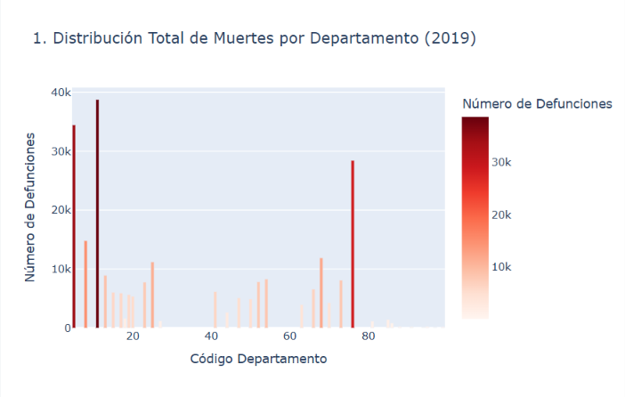

# Aplicación Web Interactiva para el Análisis de Mortalidad en Colombia (2019)

# Integrantes
John Alexander Ocoro Lerma

# Enlace de la aplicación web en la nube (PaaS - Render):

https://mortalidad-colombia-2019.onrender.com (Nota: Al estar alojada en el plan gratuito de Render, si el servidor se encuentra inactivo, la primera carga puede tomar unos segundos en despertar).

# Enlace al repositorio del proyecto en GitHub:

https://github.com/AlexanderOcoro/mortalidad_colombia_2019

## Introducción del Proyecto
Esta aplicación web dinámica desarrollada en Python utiliza (Dash) y (Plotly) para procesar, analizar y visualizar microdatos de mortalidad en Colombia correspondientes al año 2019, publicados por el DANE (Estadísticas Vitales - EEVV).

## Objetivo
Facilitar la exploración visual intuitiva de patrones demográficos, causas de defunción, distribución regional y disparidades por género y ciclo de vida en la población colombiana durante 2019.

## Estructura del Proyecto
```text
mortalidad_colombia_2019/
│
├── data/                    # Archivos Excel fuente (DANE)
│   ├── NoFetal2019.xlsx
│   ├── CodigosDeMuerte.xlsx
│   └── Divipola.xlsx
│
├── app.py                   # Script principal de la aplicación Dash
├── requirements.txt         # Dependencias del proyecto
└── README.md                # Documentación del proyecto

