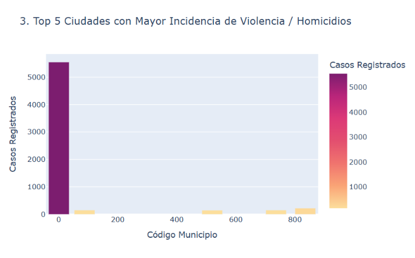
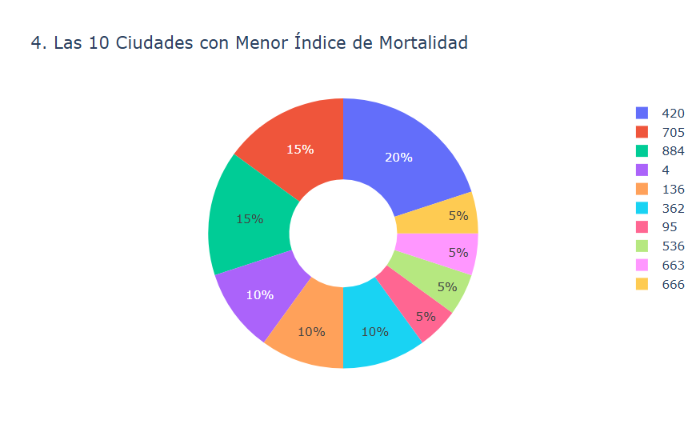
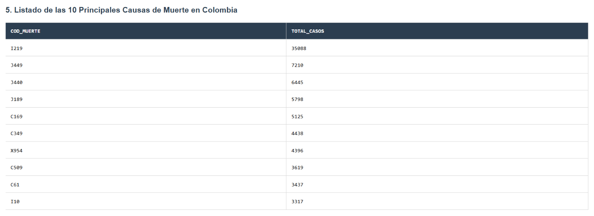

# Aplicación Web Interactiva para el Análisis de Mortalidad en Colombia (2019)

# Integrantes
John Alexander Ocoro Lerma

# Enlace de la aplicación web en la nube (PaaS - Render):

https://mortalidad-colombia-2019.onrender.com (Nota: Al estar alojada en el plan gratuito de Render, si el servidor se encuentra inactivo, la primera carga puede tomar unos segundos en despertar).

# Enlace al repositorio del proyecto en GitHub:

https://github.com/AlexanderOcoro/mortalidad_colombia_2019

## Introducción del Proyecto
Esta aplicación web dinámica desarrollada en Python utiliza (Dash) y (Plotly) para procesar, analizar y visualizar microdatos de mortalidad en Colombia correspondientes al año 2019, publicados por el DANE (Estadísticas Vitales - EEVV).

## Objetivo
Facilitar la exploración visual intuitiva de patrones demográficos, causas de defunción, distribución regional y disparidades por género y ciclo de vida en la población colombiana durante 2019.


Muestra el total de defunciones por departamento en 2019. Los picos más altos (tonos rojo oscuro, superando los 30,000 casos) evidencian los principales centros poblados del país, mientras que el resto de regiones reflejan menor concentración de registros vitales.

# 1. Distribución Total de Muertes por Departamento (2019)


Gráfico de barras que representa el volumen total de defunciones acumuladas por cada departamento, utilizando una escala de color continua donde los tonos más oscuros identifican las regiones con mayor concentración de registros

# 2. Tendencia de Mortalidad por Mes en Colombia


Gráfico de líneas con marcadores que muestra la evolución mensual de las defunciones a lo largo del año 2019, permitiendo visualizar con claridad los meses con mayores picos y descensos en la mortalidad nacional.

# 3. Top 5 Ciudades con Mayor Incidencia de Violencia / Homicidios


Gráfico de barras interactivo enfocado en destacar los municipios del país que registran las cifras más altas de muertes asociadas a la violencia y homicidios.

# 4. Las 10 Ciudades con Menor Índice de Mortalidad


Gráfico circular tipo dona que ilustra la proporción porcentual de las diez ciudades o municipios con menor cantidad de defunciones registradas.

# 5. Listado de las 10 Principales Causas de Muerte en Colombia


Tabla estructurada que detalla los códigos de las diez causas de defunción más frecuentes a nivel nacional junto con el total de casos asociados a cada una.

# 6. Comparación de Mortalidad por Sexo y Departamento


Gráfico de barras apiladas que permite contrastar y analizar la proporción de defunciones desglosada por sexo en cada departamento del país.

# 7. Distribución de Mortalidad por Ciclo de Vida (Grupo de Edad DANE)


Histograma que detalla la frecuencia de los fallecimientos agrupados según los rangos de edad y ciclos vitales definidos por el DANE.

## Estructura del Proyecto
```text
mortalidad_colombia_2019/
│
├── data/                    # Archivos Excel fuente (DANE)
│   ├── NoFetal2019.xlsx
│   ├── CodigosDeMuerte.xlsx
│   └── Divipola.xlsx
│
├── app.py                   # Script principal de la aplicación Dash
├── requirements.txt         # Dependencias del proyecto
└── README.md                # Documentación del proyecto

