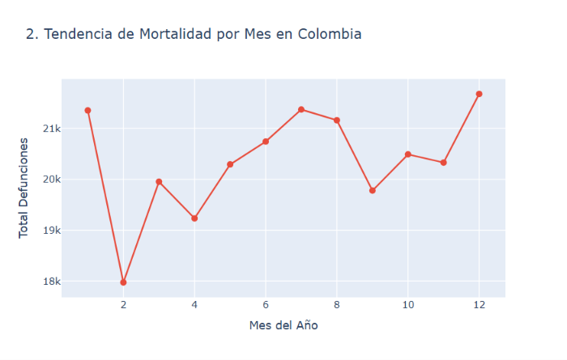
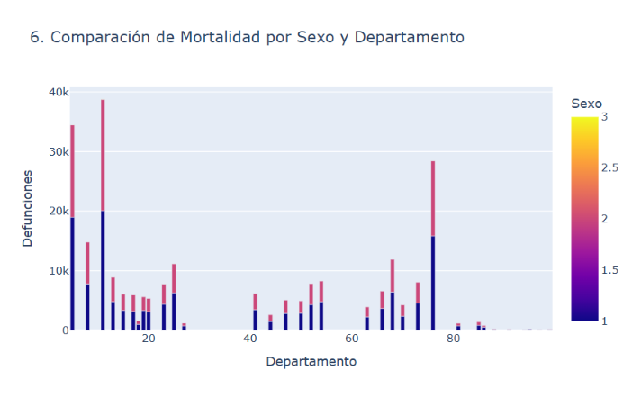
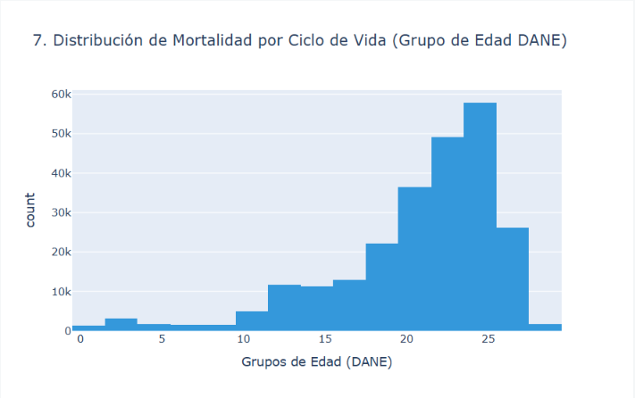

# Aplicación Web Interactiva para el Análisis de Mortalidad en Colombia (2019)

# Integrantes
John Alexander Ocoro Lerma

# Enlace de la aplicación web en la nube (PaaS - Render):

https://mortalidad-colombia-2019.onrender.com (Nota: Al estar alojada en el plan gratuito de Render, si el servidor se encuentra inactivo, la primera carga puede tomar unos segundos en despertar).

# ¿Cómo funciona la Aplicación?

Esta plataforma web interactiva opera bajo una arquitectura basada en Python, utilizando Dash y Plotly para el procesamiento y la renderización visual de los microdatos del DANE (Estadísticas Vitales de Mortalidad 2019).

# Carga de los datos:

Al iniciar, el sistema lee y normaliza de forma automatizada los archivos en formato Excel (NoFetal2019.xlsx, CodigosDeMuerte.xlsx y Divipola.xlsx) utilizando Pandas.

# Motor Gráfico:

Agrupa, filtra y procesa las variables demográficas, espaciales y temporales para generar dinámicamente 7 componentes visuales interactivos (mapas de barras departamentales, tendencias mensuales, análisis de violencia, causas de defunción, distribución por sexo y ciclos de vida por grupos etarios).

# Interfaz Web:

Se ejecuta mediante un servidor local (o en la nube a través de Gunicorn y Render), permitiendo al usuario interactuar con tablas de datos y gráficos vectoriales responsivos en tiempo real.

# Instalación y ejecucción local:

Sigue estos pasos para clonar el repositorio y ejecutar la aplicación en tu entorno de desarrollo local (como Visual Studio Code):

# 1. Clonar el repositorio

Abre tu terminal y ejecuta el siguiente comando:
git clone https://github.com/AlexanderOcoro/mortalidad_colombia_2019.git
cd mortalidad_colombia_2019

# 2. Crear y activar un entorno virtual

python -m venv .venv

# 3. Instalar las dependencias

pip install -r requirements.txt

# 4. Ejecutar la aplicación

Inicia el servidor local de desarrollo de Dash:

python app.py

Una vez ejecutado, abre tu navegador web e ingresa a la dirección: [http://127.0.0.1:8050/]para visualizar la plataforma en funcionamiento.

# Enlace al repositorio del proyecto en GitHub:

https://github.com/AlexanderOcoro/mortalidad_colombia_2019

## Introducción del Proyecto
Esta aplicación web dinámica desarrollada en Python utiliza (Dash) y (Plotly) para procesar, analizar y visualizar microdatos de mortalidad en Colombia correspondientes al año 2019, publicados por el DANE (Estadísticas Vitales - EEVV).

## Objetivo
Facilitar la exploración visual intuitiva de patrones demográficos, causas de defunción, distribución regional y disparidades por género y ciclo de vida en la población colombiana durante 2019.

## Gráficos

# 1. Distribución Total de Muertes por Departamento (2019)


Gráfico de barras interactivo con gradiente de color que muestra el volumen acumulado de defunciones por departamento, permitiendo identificar rápidamente las regiones con mayor densidad poblacional y concentración de registros.

# 2. Tendencia de Mortalidad por Mes en Colombia


Gráfico de líneas con marcadores que detalla la evolución mensual de las defunciones durante el año 2019, evidenciando los meses con mayores picos y descensos a nivel nacional.

# 3. Top 5 Ciudades con Mayor Incidencia de Violencia / Homicidios


Gráfico de barras que resalta los municipios con mayores registros de muertes asociadas a hechos violentos u homicidios en el país.

# 4. Las 10 Ciudades con Menor Índice de Mortalidad


Gráfico circular tipo dona que ilustra la distribución porcentual de los diez municipios con menor cantidad de defunciones reportadas.

# 5. Listado de las 10 Principales Causas de Muerte en Colombia


Tabla estructurada que detalla los códigos de las diez causas de defunción más frecuentes en el país junto con el número total de casos asociados a cada una.

# 6. Comparación de Mortalidad por Sexo y Departamento


Gráfico de barras apiladas que contrasta y analiza la proporción de defunciones desglosada por sexo en los diferentes departamentos.

# 7. Distribución de Mortalidad por Ciclo de Vida (Grupo de Edad DANE)


Histograma que representa la frecuencia de los fallecimientos agrupados según los rangos de edad y etapas del ciclo vital definidos por el DANE.

## Estructura del Proyecto
```text
mortalidad_colombia_2019/
│
├── data/                    # Archivos Excel fuente (DANE)
│   ├── NoFetal2019.xlsx
│   ├── CodigosDeMuerte.xlsx
│   └── Divipola.xlsx
│
├── app.py                   # Script principal de la aplicación Dash
├── requirements.txt         # Dependencias del proyecto
└── README.md                # Documentación del proyecto

